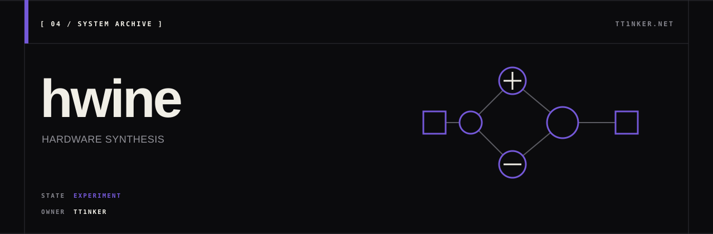

<p align="center">
  
</p>

# hwine

**hardware is not enough** — an experimental FPGA datapath optimizer using
an e-graph to explore integer arithmetic implementations.

The supported engineering path is deliberately small: **fixed-width wrapping
integer arithmetic and FIR dot products**, with checked SystemVerilog generation
and explicit, balanced pipelines. Unsupported operations return errors. This is
not a general HLS compiler or a proven optimizer for every IR atom.

The reproducible validation suite compares generated RTL with independently
written Python arithmetic, checks RTL against separate specifications using
Yosys SAT / temporal induction, and records Yosys xc7 synthesis counts. Cost-model
numbers are estimates; they are never presented as measured LUTs, DSPs or Fmax.
See the [semantics and validation contract](docs/RELIABILITY.md) and
[recorded local results](docs/VALIDATION.md).

The [ECP5 design-space experiment](docs/ECP5_EXPLORATION.md) adds verified
template/e-graph comparisons, grouped pipelines, hybrid DSP/CSD candidates,
and nextpnr placement/routing. Its constraint selector exports a measured
implementation with the associated verification evidence.
The completed 18-instance experiment verified all 417 distinct RTL candidates.
Template search reduced combinational resources on 11 instances and made one
more feasible at zero DSP / 150 MHz; the current e-graph extractor added no
resource benefit over that template baseline under the measured constraints.
Custom 2–8-input signed dot products at widths 2–16 are accepted through
`tools/explore.py --cases kernels.tsv`; the
[input format and experiment contract](docs/ECP5_EXPLORATION.md#reproduce-and-export)
include explicit coefficient ranges, latency, and wrapping semantics.
The optional `--balanced-digits` flag also searches multipliers built from
balanced positive/negative signed-digit sums. It is a later template extension,
separate from the frozen holdout comparison.

## Reproduce

On Linux x86_64 with Rustup, Python 3, curl and tar:

```bash
git clone https://github.com/TT1nKer/hwine.git
cd hwine
# Check out the commit/branch containing this README before running these steps.
cargo fmt --manifest-path hwine-rs/Cargo.toml --check
cargo clippy --manifest-path hwine-rs/Cargo.toml --lib --locked -- -D warnings
cargo test --manifest-path hwine-rs/Cargo.toml --all-targets --locked
cargo test --manifest-path hwine-rs/Cargo.toml --doc --locked
tools/with_eda.sh python3 tools/validate.py
```

Rust is pinned to 1.96.0. The last command downloads a checksum-pinned OSS CAD
Suite (2026-11-09, about 715 MiB compressed) to the user cache on first use; it
requires no sudo, Vivado or license. Existing tools can be used with
`HWINE_EDA_DIR=/absolute/path/to/oss-cad-suite tools/with_eda.sh ...`.

Evidence is written to `build/validation/`: generated RTL, stimulus vectors,
reference miters, tool commands, logs, synthesis JSON and `summary.json`.
Missing tools, simulation mismatches, failed proofs and unexpected timeouts in
the required suite fail the command. Two optional 64-bit CSD cases are explicitly
outside the default proof scope; they still require simulation. Use
`--extended-formal` to attempt their known expensive proofs as well.

## Generate a small pipelined FIR

```bash
cd hwine-rs
cargo run --locked --example stream_fir_bench
# Produces fir3.sv and prints the exact pipeline latency.
```

This computes `7*x0 + 13*x1 - 5*x2` modulo 2^16, consuming one **tap tuple** per
cycle. A caller supplies the three samples; the example does not implement a
sample-history delay line or a ready/valid interface.

The library entry point is `rtl::try_generate`, which returns the RTL, latency,
and clearly labeled estimates. `Pipeline::None`, `Output`, `EveryOp`, and
`EveryN(n)` choose combinational logic, a single output register, a balanced
operation pipeline, or cuts every `n` operation-depth levels.
See [architecture](hwine-rs/ARCHITECTURE.md) for a minimal API example.

## Evidence boundaries

- No passthrough stubs: quantization, slicing, packing, streams, accumulators and
  other operations without a checked implementation are rejected.
- E-class membership records assumed rewrite equalities. It is **not** a proof
  of the rules, finite-width behavior, or generated RTL. Proof claims refer only
  to named cases in the validation report.
- Pipeline insertion is a separate scheduling pass. A value is never unioned
  with its one-cycle-delayed value; unequal operand latencies are rejected.
- LUT/DSP/FF and delay estimates guide search. Yosys technology-mapped cell counts
  are synthesis measurements for its xc7 mapping, not Vivado results, placement,
  routing, measured clock frequency, or board validation.
- The separate ECP5 experiment reports nextpnr internal register-to-register
  timing estimates after routing. It does not establish IO timing, board Fmax,
  Xilinx performance, or global optimality.
- `paper/`, `vivado_pack/`, older examples, Python tools and the Yosys plugin are
  historical experiments outside the current acceptance scope. Their old
  performance/proof claims have not been revalidated by this work.

[CI run 42887132733](https://github.com/TT1nKer/hwine/actions/runs/42887132733)
passed on `main` at `b08b643`, including Rust checks, the required RTL suite,
and the experiment verifier controls. The workflow retains evidence even on
failure. That recorded success applies to that commit, not untested later edits.
