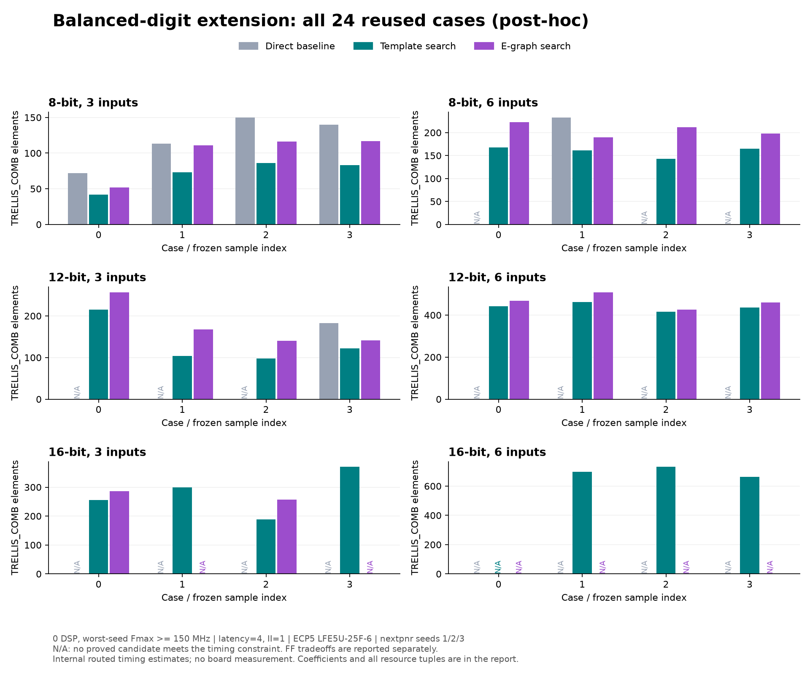

# Balanced-digit extension and Frontenac campaign outcome

Recorded 2026-11-10 Toronto / 2026-11-11 UTC. This is a **post-hoc extension
on all 24 previously inspected cases**, not an independent holdout.
The [frozen protocol](../experiments/BALANCED_DIGITS_V1.md) changes only candidate
coverage. Arithmetic is same-width signed wrapping; external latency is four
cycles, II=1. Routing targets ECP5 LFE5U-25F-6, 150 MHz, seeds 1/2/3. Selection
minimizes combinational cells, then FFs, DSPs, and finally worst-seed timing.

## Result

At zero DSP / >=150 MHz, stronger templates improve feasibility **20/24 → 23/24**.
They reduce cells on 16 of the 20 previously feasible cases (0–26.1% across all
20 paired cases; median 12.36%). Seven selected implementations use more FFs,
nine use fewer, and four use the same number. No cell/FF scalar area score is
assumed. Three wide cases become feasible at the **same four-cycle latency**.

E-graph candidates add **no selected resource improvement at 150 MHz at any
of the four DSP budgets**. They retain three resource-Pareto points across two
cases, trading more cells for fewer FFs. At 100 MHz, some nonzero-DSP selections
still benefit; the table below preserves those results. The conclusion is about
this measured candidate set, not all possible e-graph methods.

Against the weaker direct baseline, feasibility is 6/24 → 23/24. Among its six
paired-feasible cases, template cell savings are 30.9–42.7%; the 17 newly feasible
cases do not have a percentage saving. This baseline comparison does not show
that a large search is necessary or that an external synthesis tool is beaten.

## All cases at zero DSP / 150 MHz

Each tuple is **combinational cells / fabric FFs / minimum-seed MHz**. DSP use
is zero throughout this table. Expanded combined selection has the same resource
tuples as expanded templates for every feasible case. No board timing is claimed.

| Case | Frozen templates | Frozen combined | Expanded templates = combined |
| --- | --- | --- | --- |
| random3_0_s12 | 247 / 118 / 161.29 | 247 / 118 / 161.29 | 215 / 139 / 190.59 |
| random3_0_s16 | 289 / 179 / 205.17 | 286 / 173 / 199.44 | 255 / 169 / 182.18 |
| random3_0_s8 | 42 / 50 / 263.44 | 42 / 50 / 263.44 | 42 / 50 / 263.44 |
| random3_1_s12 | 130 / 108 / 229.52 | 130 / 108 / 229.52 | 104 / 107 / 245.22 |
| random3_1_s16 | 406 / 196 / 183.79 | 406 / 196 / 183.79 | 300 / 197 / 187.09 |
| random3_1_s8 | 84 / 68 / 241.31 | 84 / 68 / 241.31 | 73 / 66 / 186.08 |
| random3_2_s12 | 124 / 106 / 237.76 | 124 / 106 / 237.76 | 98 / 99 / 247.95 |
| random3_2_s16 | 243 / 159 / 199.16 | 243 / 159 / 199.16 | 188 / 175 / 223.56 |
| random3_2_s8 | 100 / 86 / 241.31 | 100 / 86 / 241.31 | 86 / 76 / 232.18 |
| random3_3_s12 | 150 / 106 / 229.10 | 141 / 109 / 245.28 | 122 / 112 / 241.43 |
| random3_3_s16 | 415 / 177 / 158.48 | 415 / 177 / 158.48 | 370 / 182 / 190.84 |
| random3_3_s8 | 88 / 76 / 199.24 | 88 / 76 / 199.24 | 83 / 71 / 206.87 |
| random6_0_s12 | 455 / 226 / 155.06 | 455 / 226 / 155.06 | 443 / 212 / 158.86 |
| random6_0_s16 | infeasible | infeasible | infeasible |
| random6_0_s8 | 168 / 118 / 225.89 | 168 / 118 / 225.89 | 168 / 118 / 225.89 |
| random6_1_s12 | 462 / 221 / 155.23 | 462 / 221 / 155.23 | 462 / 221 / 155.23 |
| random6_1_s16 | infeasible | infeasible | 697 / 301 / 154.80 |
| random6_1_s8 | 161 / 122 / 202.68 | 161 / 122 / 202.68 | 161 / 122 / 202.68 |
| random6_2_s12 | 440 / 199 / 162.68 | 426 / 200 / 161.11 | 416 / 200 / 166.42 |
| random6_2_s16 | infeasible | infeasible | 731 / 333 / 160.59 |
| random6_2_s8 | 166 / 103 / 192.86 | 166 / 103 / 192.86 | 143 / 112 / 186.15 |
| random6_3_s12 | 458 / 243 / 165.37 | 458 / 243 / 165.37 | 436 / 207 / 165.89 |
| random6_3_s16 | infeasible | infeasible | 662 / 288 / 152.32 |
| random6_3_s8 | 190 / 127 / 200.56 | 190 / 127 / 200.56 | 165 / 124 / 184.43 |



A selected design need not get faster: `random3_0_s16` changes from
289 cells / 179 FF / 205.17 MHz to 255 / 169 / 182.18 MHz. The older design remains
available when selecting at 200 MHz. This is constraint-specific selection.

## DSP budgets and frequency sensitivity

Feasibility counts have denominator 24. T = template-only, A = all candidates.
The final column counts cases where e-graph selection improves the ordered
cell/FF/DSP objective beyond the **expanded** template set. Budgets and frequency
thresholds reuse the same layouts; they are not independent experiments and
100/200 MHz are selection thresholds, not separately routed target frequencies.

| MHz | DSP budget | Frozen T / A | Expanded T / A | E-graph improves selection |
| --- | --- | --- | --- | --- |
| 100 | 0 | 24 / 24 | 24 / 24 | 0 |
| 100 | 1 | 24 / 24 | 24 / 24 | 3 |
| 100 | 2 | 24 / 24 | 24 / 24 | 8 |
| 100 | unlimited | 24 / 24 | 24 / 24 | 1 |
| 150 | 0 | 20 / 20 | 23 / 23 | 0 |
| 150 | 1 | 20 / 20 | 23 / 23 | 0 |
| 150 | 2 | 20 / 20 | 23 / 23 | 0 |
| 150 | unlimited | 20 / 20 | 23 / 23 | 0 |
| 200 | 0 | 12 / 13 | 13 / 13 | 0 |
| 200 | 1 | 12 / 13 | 13 / 13 | 0 |
| 200 | 2 | 12 / 13 | 13 / 13 | 0 |
| 200 | unlimited | 12 / 13 | 13 / 13 | 0 |

The remaining >=150 MHz e-graph frontier additions are:

| Case | Cells | FF | DSP | Worst-seed MHz |
| --- | --- | --- | --- | --- |
| random3_3_s12 | 141 | 109 | 0 | 245.28 |
| random6_3_s8 | 207 | 94 | 0 | 154.01 |
| random6_3_s8 | 198 | 116 | 0 | 174.58 |

All candidate hashes, aliases and per-seed frequencies, including the other
budget selections and FF tradeoffs, are in the
[machine-readable analysis](ecp5-balanced24-2026-11-10.json).

## Six/eight-cycle outcomes

| Job | Source | Outcome | Elapsed |
| --- | --- | --- | --- |
| 12448218, four-cycle full24 | `5b49848c6c5129ee400ed0fad8dcb5b9036ae28e` | COMPLETED, 0:0 | 47m10s |
| 12448265, six-cycle four wide cases | `74991c282d8853a7f47da7555b24ffe358f14189` | FAILED, 1:0 | 1h06m23s |
| 12448266, eight-cycle same cases | same as six-cycle | CANCELLED after dependency failure; never started | 0s |

The six-cycle batch generated 148 distinct RTLs. Its progress snapshot has 79
proved result records; workers continued during executor shutdown, leaving 146
logs with both proof phases passed and two with solver `unknown`. There is no
complete summary and **no audited six-cycle feasibility or resource comparison**.
Eight cycles have no measurements. Its cancellation follows the failed
`afterok` dependency and the recorded `kill-on-invalid-dep=yes` setting; this
cause is inferred from that sequence (the accounting Reason field is `None`). In particular, these outcomes cannot support
a claim that extra latency improves the four wide cases.

Both unknowns concern `random6_2_s16`: `csd_balanced_p2` and `mixed_2_p2`.
Both base checks end at 45 seconds. The pinned Yosys adapter passes Bitwuzla
`--time-limit 45000`; this is consistent with reaching the configured solver
limit. The driver recognizes the words `timeout`/`timed out`, but treats
`unknown` as an exception. No `Status: FAILED` counterexample marker was found.
Unknown is still unproved: neither a correctness success nor proof of a design
bug. Slurm reports process failure, not an OOM or job time-limit failure.

The frozen policy was not changed, no job was resubmitted, and partial caches
were not converted into a successful experiment. A future explicit retry would
first need conservative unknown-result handling, preserving every unproved
candidate and excluding it from selection. The existing campaign is closed
with the failed/cancelled outcomes; the automatic follow-up is stopped.
See [job outcomes, hashes and diagnostic](frontenac-campaign-outcome-2026-11-10.json)
and [retained scheduler/proof logs](evidence/frontenac-20261111/).

## Evidence and reproduction

The successful four-cycle run verifies **612 distinct RTLs / 654 aliases**,
1,272,060 simulation comparisons, 248 source certificates, 612 sequential
proofs, 1,224 synthesis records and 3,138 distinct routes. No unproved candidates,
proof timeouts, synthesis failures or routing failures occurred in this run.

The [historical-source audit](frontenac-balanced24-audit-2026-11-10.json) checks
recorded source hashes against `5b49848`. The
[full extension comparison](frontenac-balanced24-comparison-2026-11-10.json)
checks all 551 retained baseline RTLs and their proof results, resources and
every seed's Fmax. There are 61 new RTLs. All 1,102 shared synthesis netlists
match after normalizing only the explicitly recorded EDA installation prefix in
`attributes.src`; this does not normalize logic, timing or source line numbers.
Raw evidence is retained locally under `build/frontenac-balanced24-20261111`
and `build/frontenac-latency6-20261111`, and in the original Frontenac output
directories. Git retains compact analysis, audit, comparison and failure evidence.

With the existing downloaded raw evidence (no new EDA run):

```bash
python3 tools/audit_exploration.py build/frontenac-balanced24-20261111/summary.json \
  --source-commit 5b49848c6c5129ee400ed0fad8dcb5b9036ae28e \
  --out build/balanced24-audit.json
python3 tools/compare_candidate_extension.py build/ecp5-holdout-v1/summary.json \
  build/frontenac-balanced24-20261111/summary.json \
  --left-eda-root /home/hostsjim/.local/opt/hwine-eda-20261109/oss-cad-suite \
  --right-eda-root /global/teaching-home/sa6079074/hwine/runtime/cache/hwine-eda/2026-11-09/oss-cad-suite \
  --out build/balanced24-comparison.json
python3 tools/explore_report.py build/frontenac-balanced24-20261111/summary.json \
  --out build/balanced24-analysis.json
python3 tools/plot_holdout.py build/frontenac-balanced24-20261111/summary.json \
  --out build/balanced24-plot \
  --title 'Balanced-digit extension: all 24 reused cases (post-hoc)'
```

This evidence improves the engineering result while weakening the case for the
current e-graph search as the project's distinctive contribution. See the
[investment reassessment](PROJECT_REASSESSMENT.md).
