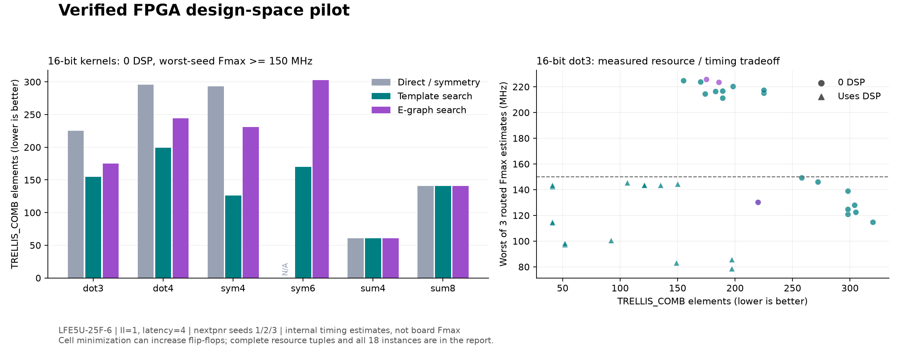

# Verified ECP5 design-space experiment

This is a bounded experiment in resource-constrained arithmetic-kernel search.
It compares direct RTL structure, ordinary structural templates, and hwine's
current e-graph extraction using actual synthesis and placement/routing.
The cost model is not used as a substitute for measured resource/timing data.

## Results — 2026-11-10

**Measured search is useful on this corpus; the current e-graph extractor has
not demonstrated an independent resource benefit over the template baseline.**
The completed run used source commit
`7832b68e5109aef524468f36a535c0017830fa33` and the pinned tool versions recorded in
[the machine-readable results](ecp5-exploration-2026-11-10.json).

- 18 kernel instances, 543 generated variants, 417 distinct RTL implementations.
- All 417 passed simulation and the source/pipeline checks described below:
  866,877 simulated comparisons, 141 distinct modular-linear source certificates,
  and 417 SMT base-plus-induction proofs. No candidate remained unproved.
- 834 synthesis options (automatic DSP mapping and `-nodsp`), with 2,115 distinct
  routing runs after exact-netlist deduplication, using three seeds each.
- At zero DSP and >=150 MHz, templates reduced combinational cells for 11 of
  18 instances versus the basic baseline, by **16.9%–57.0%**. One additional
  instance became feasible; the six pure-addition instances were unchanged.
- Adding the e-graph candidates improved resources in **0 of 72** primary
  case/budget comparisons. At >=150 MHz, they also added **no resource-Pareto
  point** in the joint combinational-cell / fabric-FF / DSP space. The absence
  of benefit is therefore not just a consequence of minimizing cells first.
  The 100- and 200-MHz sensitivity queries likewise gave no resource improvement
  under the stated selection objective. These reuse the 150-MHz-targeted routes.

The following table shows all six **16-bit** families at zero DSP and >=150 MHz.
Each entry is `combinational cells / fabric FFs / worst-seed MHz`. A candidate
with fewer combinational cells can use more FFs or have a lower Fmax estimate.

| Kernel | Basic | Template | E-graph |
| --- | ---: | ---: | ---: |
| dot3 | 225 / 144 / 217.30 | **155 / 154 / 224.72** | 175 / 154 / 225.68 |
| dot4 | 296 / 176 / 221.78 | **199 / 190 / 224.16** | 244 / 144 / 191.46 |
| sym4 | 293 / 176 / 210.04 | **126 / 138 / 189.18** | 231 / 196 / 226.50 |
| sym6 | Infeasible | **170 / 176 / 195.50** | 303 / 240 / 213.08 |
| sum4 | 61 / 128 / 300.12 | 61 / 128 / 300.12 | 61 / 128 / 300.12 |
| sum8 | 141 / 240 / 298.60 | 141 / 240 / 298.60 | 141 / 240 / 298.60 |



For the exported `dot3_s16_csd_balanced_p2`, combinational cells decrease from
225 to 155 (**31.1%**) while fabric FFs increase from 144 to 154. Both use zero
DSP, latency four, and II=1. Its three routed Fmax estimates are 226.86, 224.72,
and 230.84 MHz. These are internal timing estimates, not board measurements.
The local export is `build/selected-dot3-s16.tar.gz` and contains RTL, proof and
simulation inputs, commands, synthesis results, and all three route reports.
Simulation, symbolic source checking, and SMT base/induction were rerun from
the exported bundle and passed.

A clean checkout of the recorded commit separately regenerated all 21 distinct
`dot3_s16` implementations. RTL hashes, aliases, simulation counts, proof status,
synthesis cell maps, and every seed's timing and utilization matched the main
run exactly. An evidence audit checked all 417 RTL/proof records, rechecked all
141 source certificates, and matched synthesis/routing reports to their input
netlist hashes. A cached full replay also completed successfully.

The wider integer regression remains separate: **267 RTL implementations,
2,061,851 simulation comparisons, 265 SAT proofs, and 21 xc7 synthesis checks**.
Two pre-existing 64-bit CSD cases remain simulation-only. The original 249 RTL
fixtures are byte-identical after adding grouped pipelines. Rust validation
passed 26 unit, 12 integration, and 4 doc tests; the library and the two relevant
examples passed Clippy with warnings denied. See the
[regression record](grouped-validation-2026-11-10.json). After integration into
`main`, [remote CI passed on b08b643](https://github.com/TT1nKer/hwine/actions/runs/42887132733).

### What this supports

The concrete deliverable is a **verified, measured constraint explorer**:
choose a kernel and resource/timing constraints, then receive feasible RTL with
replayable evidence, or an explicit infeasible result. Keep e-graph extraction
as one candidate source until it earns its additional complexity against strong
templates. This experiment does not establish a new optimization algorithm or
an advantage over existing research and vendor tools.

The next decision-changing work is to evaluate a held-out set of wider,
arbitrary coefficients; support explicit full-precision or rounding/saturation
contracts; and validate one selected implementation on a board. For an
e-graph-specific research claim, first require repeatable resource or feasibility
improvements beyond templates on held-out kernels with the same verification
and timing contract. Larger search spaces or a richer cost model alone would
not satisfy that criterion.

## Fixed workload and comparison contract

There are 18 instances: each of the following coefficient vectors at signed
8-, 12-, and 16-bit widths. All operations and the result wrap modulo 2^W.

| Family | Coefficients | Meaning |
| --- | --- | --- |
| dot3 | 7, 13, -5 | Independent-input dot product |
| dot4 | 3, -5, 11, 7 | Independent-input dot product |
| sym4 | 7, 13, 13, 7 | Symmetric FIR arithmetic kernel |
| sym6 | 3, 5, 7, 7, 5, 3 | Symmetric FIR arithmetic kernel |
| sum4 | 1, 1, 1, 1 | Reduction |
| sum8 | 1, 1, 1, 1, 1, 1, 1, 1 | Reduction |

Every implementation accepts a new independent input tuple each cycle (II=1).
The external latency is exactly four register stages: one common input stage,
one to three core stages, and any necessary output padding. All registers have
synchronous active-low reset. Outputs are valid after four non-reset fill edges.
There is no sample-history delay line, stall, ready/valid interface, widened
accumulation, rounding, or saturation.

The candidate groups are:

- **Basic:** direct balanced arithmetic; explicit symmetric input pre-addition
  where applicable. Both automatic DSP mapping and `-nodsp` are available.
- **Template:** basic candidates plus left-associated trees, ordinary CSD,
  symmetric CSD, and hybrids keeping one selected multiplication in native `*`
  form while expressing the others as CSD. Native `*` is not a guarantee of DSP
  inference; the measured count is authoritative. This is the no-egraph search
  ablation and is the primary baseline for claims about e-graph value.
- **E-graph:** saturation of the balanced expression (8 iterations / 2,500 class
  stopping threshold), then existing MinDelay and MinDsp extraction. These use
  the existing uncalibrated cost model, which includes DSP48-style assumptions;
  it has not been fitted to ECP5 or to this experiment.

All groups have the same scheduling choices: an output register, or EveryN with
n=1, 2, 3, keeping only core latencies <=3. The scheduler counts operation depth,
including constant shifts, rather than a physical timing estimate. No data
dependent candidate tuning is done. Exact duplicate RTL is measured once with
all its group aliases retained; byte-identical mapped netlists share routing
results. The search is a finite enumeration, not a global optimizer. It does
not enumerate every combination of native and CSD multipliers or every cut.

## Measurement and selection

- Device: Lattice LFE5U-25F, speed grade 6, CABGA381.
- Synthesis: `synth_ecp5`, with automatic DSP mapping and with `-nodsp`.
- Placement/routing: nextpnr-ecp5, target 150 MHz, seeds 1, 2, 3. Timing failures
  are retained as measured infeasible points, not silently discarded.
- Clock metric: the **minimum** reported post-route internal register-to-register
  Fmax over the three seeds. IO locations are unconstrained and IO delay is not
  specified. This does not establish IO timing or board Fmax. The shell input
  registers ensure arithmetic is measured between registers.
- Resources: post-pack `TRELLIS_COMB`, fabric `TRELLIS_FF`, and `MULT18X18D` counts.
  TRELLIS_COMB includes carry-mode combinational elements; it is **not** a count
  of Xilinx LUTs. Fabric FF counts do not include DSP-internal registers.
- Primary comparison: minimum combinational cells at >=150 MHz and DSP budgets
  0, 1, 2, or unrestricted. Ties minimize fabric FFs, then DSPs, then maximize
  worst-seed Fmax. A reduction in combinational cells can cost more FFs; report
  the whole tuple rather than calling it a blanket area improvement.

Each primary comparison uses the same latency, throughput, target, and timing
constraint. All budgets for one kernel share data; they are not independent
statistical trials. Three seeds are a sensitivity check, not a statistical
guarantee. Sensitivity queries at other frequency requirements reuse these same
150-MHz-targeted layouts; they do not imply placement was retuned at that target.

## Independent correctness checks

1. Python arbitrary-precision dot products, reduced modulo 2^W, generate edge,
   single-input-edge, and 2,048 seeded random tuples. Icarus drives changing
   inputs every cycle, checks four-cycle latency, and reasserts reset midstream.
2. `linear_check.py` reads **Yosys frontend JSON of the emitted combinational
   RTL**, independently of hwine's IR/extraction. It assigns each complete
   W-bit vector an affine form `b + sum(a_i*x_i) mod 2^W`. Equal-width add/subtract,
   multiplication by a constant, and unsigned constant left shift preserve this
   form. Equality to the supplied coefficient vector establishes the result for
   every input bit pattern. Signedness does not change the low W bits of these
   equal-width operations. Every other operation, nonlinear multiplication,
   mixed-width arithmetic, unknown bits, cycles, and partial-vector wiring is
   rejected. Certificates retain each checked coefficient vector and RTL/JSON
   hashes. **The Yosys frontend, Python arithmetic, and this restricted checker
   are trusted; the checker itself is not formally verified.** This result is
   explicitly labeled symbolic normalization, not a SAT proof.
3. Yosys SMTBMC with Bitwuzla proves the actual four-cycle scheduled RTL
   equivalent to that exact combinational source delayed by four cycles. DUT
   registers start arbitrarily; only checker valid/reset history is initialized.
   Reset can occur at any time. Reset output zero is checked as well as filled
   pipeline equivalence. Both the six-step base check (with assumption
   consistency checks) and k-induction with maximum depth six must pass. This
   establishes an unbounded property, not just six-cycle simulation. A timeout
   is unproved and excluded from selection. See the
   [YosysHQ engine reference](https://yosyshq.readthedocs.io/projects/sby/en/latest/reference.html)
   for the distinction between bounded checking and unbounded proving.
4. Wrong oracle, off-by-one latency, and disabled reset controls must fail both
   simulation and the relevant formal engine (SAT for the combinational oracle,
   SMTBMC for pipeline/reset mutants). Seven restricted-verifier examples are independently
   cross-checked by SAT; seven incorrect coefficient sets and seven unsupported
   structures must be rejected.

The symbolic checker was added after the initial SAT-only pilot timed out on
some symmetric distributive identities, including 8-bit ones. Omitting these
otherwise valid templates would weaken the baseline. Its narrow algebraic
domain avoids that bottleneck while retaining independent cycle/reset checks.
The general integer acceptance suite continues to use its existing SAT-based
source proofs; it is not replaced with this special-purpose checker.

The first sequential pilot used bit-blasted SAT induction. A retained 12-bit
hybrid example took about 50 seconds there, versus about 3 seconds for SMTBMC's
base plus induction checks in a diagnostic rerun. These are single-run wall
times under system load, not a controlled solver benchmark. The final experiment
uniformly uses the word-level SMT flow and records its actual per-case times.

## Reproduce and export

Use the pinned tools described in [RELIABILITY.md](RELIABILITY.md). Python tooling
uses the standard library; plotting, when requested, additionally uses matplotlib.

Custom independent-input dot products are accepted with `--cases kernels.tsv`.
The TSV header is `case`, `width`, `coefficients` separated by tabs. Each row has
a unique ASCII name starting with a letter, width 2..16, and 2..8 comma-separated
signed coefficients representable at that width. Zero coefficients are allowed;
the all-zero vector is rejected. Inputs and output all have the declared width
and wrap modulo 2^W. Invalid manifests fail before fixture output is written.

For example, one data row can be `my_dot`, `16`, `32767,-32768,0,-1` (tab-separated).
Run the normal experiment with `--cases kernels.tsv`, then select it with
`--case my_dot`. The input manifest snapshot/hash, exact coefficients, and width
are retained in run/export metadata. See the frozen
[arbitrary-coefficient holdout protocol](../experiments/HOLDOUT_V1.md).

`--balanced-digits` adds a later template that balances positive and negative
signed-digit sums within each constant multiplier. The default candidate set
is unchanged. This opt-in extension was motivated by a post-holdout diagnostic;
results with it enabled are not part of the frozen comparison at `6afa5d1`.
Generator builds now use source-content-specific Cargo target directories so
different source copies cannot silently reuse a stale same-named executable.

```bash
tools/with_eda.sh python3 tools/validate.py
tools/with_eda.sh python3 tools/check_linear.py --out build/linear-check
tools/with_eda.sh python3 tools/explore.py --out build/ecp5-exploration --jobs 2
tools/with_eda.sh python3 tools/check_explore.py \
  --rtl-dir build/ecp5-exploration/rtl --out build/explore-negative-controls
python3 tools/explore_report.py build/ecp5-exploration/summary.json \
  --out build/ecp5-exploration/analysis.json

# Select only among proved, measured candidates. An infeasible request fails.
python3 tools/explore_report.py build/ecp5-exploration/summary.json \
  --case dot3_s16 --max-dsp 0 --min-mhz 150 \
  --export build/selected-dot3-s16
```

The export directory must be empty. The selected `dut` is `top.sv` + `kernel.sv`;
proofs, simulation vectors, mapped netlist, route reports, commands, and selection
metadata accompany it. It is an implementation for the listed coefficient/width
instance, not an arbitrary-FIR compiler frontend.

Interrupted experiments can be resumed with the same command. Content-addressed
caches include exact RTL, tools, checking policy, and verifier code. A successful
`summary.json` is removed before starting and recreated only after completion.
Unexpected tool/proof failures abort the run; proof timeouts remain explicitly
unproved records. Full raw evidence is local under `build/ecp5-exploration/`.

## Limits and interpretation

This small corpus does not establish advantages over vendor IP, hand-tuned DSP
primitive instantiation, commercial HLS, ASIC synthesis, ROVER, or other FPGA
families. There is no board experiment, power estimate, post-synthesis equivalence
check, global DAG extraction, or globally optimal register placement. Synthesis,
technology mapping, and nextpnr remain trusted downstream tools.

The chosen small constants and symmetric coefficient vectors deliberately
exercise opportunities favorable to CSD and pre-addition. They are not a random
sample of signal-processing workloads; arbitrary coefficients and full-precision
FIR implementations need separate evaluation.

An e-graph contribution must improve over the template group under the same
constraints. Merely beating direct RTL, selecting a different resource tradeoff,
or improving the heuristic cost does not establish that contribution.
