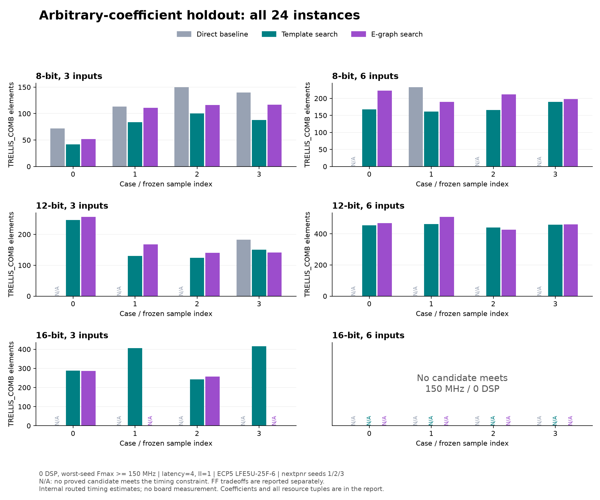

# ECP5 arbitrary-coefficient holdout — 2026-11-10

This follow-up tests whether the first experiment's small-constant results
transfer to full-width signed coefficients. It also ships custom kernel input,
an optional stronger CSD template, source-isolated generator builds, and a raw
evidence audit. The frozen experiment and the later diagnostic are separate.

## Frozen experiment

The [protocol](../experiments/HOLDOUT_V1.md) and
[24 coefficient vectors](../experiments/holdout-v1.tsv) were committed and pushed
before the full run at `6afa5d12e269e0b86a451c0a2fa956006fc5666f`.
The sample has four independent vectors for each combination of 8/12/16-bit
width and 3/6 inputs, using a declared fixed seed and the complete signed range.
There was no selection for favorable constants, symmetry, or physical results.
The manifest SHA-256 is
`ac4d16ef2e68dea2094b181f2237f84484390047f9fb93fdda20c926c96efa27`.

All arithmetic wraps modulo 2^W. External latency is four cycles and II=1.
Source checking, reset/cycle proofs, and physical selection follow the
[original contract](ECP5_EXPLORATION.md): LFE5U-25F-6 CABGA381, nextpnr target
150 MHz, minimum internal Fmax estimate over seeds 1/2/3. IO is unconstrained;
this is not board timing. The candidate policy, e-graph rules/extractors, and
pipeline cuts were held fixed for this run.

The run completed with **590 generated variants, 551 distinct RTL
implementations, 1,145,347 simulation comparisons, 225 source certificates,
551 SMT base-plus-induction proofs, and 2,958 distinct routing runs**. All
implementations passed verification; there were no proof timeouts. The evidence
audit passed for all records. Synthesis evaluated 1,102 mapping options.

At **zero DSP and >=150 MHz**, templates made 20 of 24 cases feasible versus
six for the basic baseline. All six paired-feasible cases used fewer
combinational cells, by **18.0%–41.7%** (median 32.1% across those six).
Fourteen additional cases became feasible. All four 16-bit/six-input cases
remained infeasible in this candidate set; they are retained in the results.

| Input width | Inputs | Basic feasible | Template feasible | Newly feasible | E-graph lowers cells beyond templates |
| --- | ---: | ---: | ---: | ---: | ---: |
| 8 | 3 | 4/4 | 4/4 | 0 | 0 |
| 8 | 6 | 1/4 | 4/4 | 3 | 0 |
| 12 | 3 | 1/4 | 4/4 | 3 | 1 |
| 12 | 6 | 0/4 | 4/4 | 4 | 1 |
| 16 | 3 | 0/4 | 4/4 | 4 | 1 |
| 16 | 6 | 0/4 | 0/4 | 0 | 0 |



The frozen e-graph extractor provides incremental cell improvements on three
cases. The full resource tuples show that two of these improvements cost FFs:

| Case | Template cells / FF | E-graph cells / FF | Cell reduction |
| --- | ---: | ---: | ---: |
| random3_3_s12 | 150 / 106 | 141 / 109 | 6.0% |
| random6_2_s12 | 440 / 199 | 426 / 200 | 3.2% |
| random3_0_s16 | 289 / 179 | 286 / 173 | 1.0% |

Across all four DSP budgets, this is **12 improved comparisons out of 96**,
with 68 equal-resource outcomes and 16 without a feasible design. Those 12
improvements represent **three kernels**, not 12 independent successes.
At >=150 MHz, e-graph candidates additionally contribute **nine resource-Pareto
points across eight kernels**, considering cells, FFs, and DSPs jointly. Thus
their contribution includes register tradeoffs beyond the three cell winners.
There is no additional feasible kernel at this primary threshold.

Frequency sensitivity changes the picture. At 100 MHz, all 24 kernels become
feasible with templates even at zero DSP. With DSP budget two, e-graph candidates
improve the resource objective on eight kernels; with unlimited DSP the count
is one. At 200 MHz and zero DSP, templates cover 12 kernels and the combined set
covers 13; e-graph adds one feasible case and reduces cells on one other case.
These queries reuse the same layouts. At the primary 150-MHz threshold, only
four of 447 DSP-using mapping options meet timing, so the four budgets provide
limited independent variation. Native DSP inference is not a tuned primitive-
pipeline baseline.

Full coefficients, resource tuples, frequency/budget aggregates, frontier
additions, exact output-range bounds, and evidence metadata are in the
[machine-readable record](ecp5-holdout-v1-2026-11-10.json). The results support
retaining e-graph as a complementary candidate source; they do not establish
general superiority over structural templates.

## Post-hoc diagnostic and a shipped template

The first 16-bit case, `random3_0_s16`, computes
`-632*x0 - 30963*x1 + 8920*x2` modulo 2^16. At zero DSP and >=150 MHz, the
frozen basic baseline had no feasible candidate. The frozen template winner
used 289 combinational cells and 179 fabric FFs. E-graph extraction improved
those counts slightly, to 286 and 173, with a lower but still feasible Fmax.

Inspection showed different association/order of the signed-digit terms. Two
additional templates were then tested on this case, **after observing that
gain**. They are not independent holdout evidence and do not replace any frozen
comparison above. Both underwent the same source, simulation, pipeline, and
three-seed physical checks.

| Implementation | TRELLIS_COMB | Fabric FF | DSP | Worst-seed MHz |
| --- | ---: | ---: | ---: | ---: |
| Frozen template | 289 | 179 | 0 | 205.17 |
| Frozen e-graph | 286 | 173 | 0 | 199.44 |
| Natural low-to-high digit order | 309 | 170 | 0 | 210.13 |
| Balanced positive/negative digit sums | **255** | **169** | 0 | 182.18 |

Balancing the positive terms and negative terms separately, then subtracting,
reduces cells by **11.8%** and FFs by **5.6%** versus the frozen template on this
one case. It also dominates the frozen e-graph resource tuple at >=150 MHz.
It does not meet 200 MHz; the original template still does. This is a measured
resource/timing tradeoff, not a blanket speed improvement or a claim that all
e-graph gains disappear with richer templates.

The new `--balanced-digits` option is shipped at
`c65d2aaedf5a697571c2a775e342bf74aaa40af5`. It adds the candidate without changing
the default set. With the flag off, all 1,181 files of the frozen generation
remain byte-identical. The option adds no new arithmetic semantics or rewrite
rule to the library.

The public CLI was rerun for this case with the option enabled: 22 distinct RTL
implementations, 45,518 simulation comparisons, nine source certificates, 22
pipeline proofs, and 108 distinct routing runs all completed. The added RTL
matches the diagnostic prototype byte-for-byte. No full 24-case evaluation of
this expanded template set is claimed.

```bash
tools/with_eda.sh python3 tools/explore.py \
  --cases experiments/holdout-v1.tsv --filter random3_0_s16 \
  --balanced-digits --out build/ecp5-expanded-csd-example

# 255 cells / 169 FF, worst routed estimate 182.18 MHz
python3 tools/explore_report.py build/ecp5-expanded-csd-example/summary.json \
  --case random3_0_s16 --max-dsp 0 --min-mhz 150 --export build/selected-150

# 289 cells / 179 FF, worst routed estimate 205.17 MHz
python3 tools/explore_report.py build/ecp5-expanded-csd-example/summary.json \
  --case random3_0_s16 --max-dsp 0 --min-mhz 200 --export build/selected-200
```

Both exported bundles were independently replayed: source normalization,
simulation, SMT base checking, and induction passed. The local combined package
is `build/selected-holdout-implementations.tar.gz`. Selection at 200 MHz reuses
the 150-MHz-targeted layouts; it is not a separately optimized 200-MHz placement.

## Reproducibility and checks

A clean source snapshot independently reproduced all 19 implementations of
`random3_0_s16`: RTL, aliases, comparison counts, proof status, mapped netlist
hashes/resources, and all seed timing/utilization matched. A separate fresh
generator build also reproduced all 1,181 frozen fixture files exactly.

An initial balanced-template diagnostic was excluded: two copied source trees
sharing a Cargo target directory reused the natural-order generator executable
because of the build cache's freshness decision. The corrected diagnostic used
a fresh isolated target. The shipped driver now selects the target directory
using actual source hashes and the Rust version. The fresh full-generation
comparison confirms that the frozen main experiment was unaffected. The
discarded attempt and its exclusion note are retained locally.

Full raw evidence, the clean reproduction, both diagnostics (including the
excluded attempt), and replayed implementations are archived locally in
`build/ecp5-holdout-evidence-2026-11-10.tar.gz`. Its checksum and size are in the
machine-readable record. The committed report and source are available on
GitHub; the larger raw archive is a local artifact.

`tools/audit_exploration.py` checks source hashes against a specified commit,
case/alias coverage, actual RTL hashes, source/pipeline proof composition,
certificate normalization, independently recalculated simulation vectors,
synthesis input hashes, and all route resources/timing. It also verifies proof
success logs or explicit timeouts. Deliberately corrupted RTL-hash, coefficient,
and timing records were rejected. It is an evidence-consistency audit, not a
proof of the compiler or a post-synthesis equivalence check.

```bash
python3 tools/audit_exploration.py build/ecp5-holdout-v1/summary.json \
  --source-commit 6afa5d1 --out build/holdout-audit.json
```

Custom-input checks now accept and prove eight generated boundary examples
plus one independently written leaf, and reject 14 invalid manifests. The
general integer acceptance suite retains its two explicitly excluded 64-bit
CSD source proofs. Both implementation commits passed GitHub CI:
[6afa5d1](https://github.com/TT1nKer/hwine/actions/runs/42888055195) and
[c65d2aa](https://github.com/TT1nKer/hwine/actions/runs/42892784450).

## Interpretation and next boundary

One seed and four coefficient vectors per stratum are a small experiment, not
a representative sample of real DSP applications. E-graph value must be judged
against the declared template set at the same constraints. The post-hoc case
shows why a small win over one template set is insufficient to establish an
algorithmic advantage over stronger ordinary templates.

The concrete tool now accepts custom coefficient vectors, verifies candidates,
measures resource/timing tradeoffs, and exports a feasible implementation with
replayable evidence. It reports when its finite candidate set has no solution;
this is not a proof that no circuit can meet the constraints.

Full precision remains unimplemented. For these exact coefficients and
independent signed inputs, tight mathematical output ranges require 15–17 bits
for the 8-bit instances, 23–25 bits for the 12-bit instances, and 31–33 bits for
the 16-bit instances. Thus the current wrapped results do not establish the
cost of real full-precision filters. The four wide six-input failures also
motivate configurable latency and timing-aware pipeline cuts instead of the
fixed four-cycle shell and operation-count cuts. An exact-accumulator contract
with sign extension and overflow bounds then needs its own physical comparison.
Rounding, saturation, sample history, stalls, and board validation remain
separate work.
